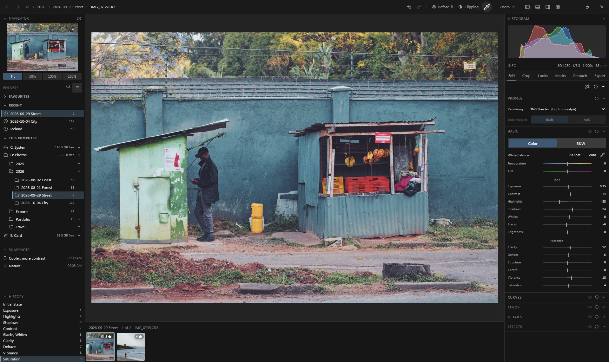

# Argentum

**A RAW photo editor** that opens a RAW the way Lightroom does, built from the
best parts of open-source photo editing, harvested one tool at a time.

Argentum began as a fork of [RapidRAW](https://github.com/CyberTimon/RapidRAW) by
Timon Käch, whose GPU pipeline, catalogue and editing panels are still most of the
application. It is becoming an editor of its own: a processing engine where every
tool is one file in a registry, with tools taken from
[darktable](https://github.com/darktable-org/darktable),
[RawTherapee](https://github.com/RawTherapee/RawTherapee),
[RAWmakase](https://github.com/pch/rawmakase) and RapidRAW, each credited to the
file and commit it came from.

RapidRAW is now a source like the others, reviewed once per release, rather than a
base merged forever. How and why is in [docs/ARCHITECTURE.md](docs/ARCHITECTURE.md).



> **Early preview.** Argentum is developed and used on Windows, and runs on
> macOS (Apple Silicon); Linux is not yet proven. Editing is non-destructive —
> your RAW files are never written to — but keep your own backups, as you would
> with any young tool.

> Argentum is independently maintained and is **not affiliated with, nor endorsed
> by, RapidRAW or darktable.** It is a fork, and it says so because their work
> deserves the credit, not because they have any part in this one.

---

## Status

**Early preview**, used daily on Windows.

| Platform | State |
|---|---|
| **Windows** | Tested. The platform it is developed on |
| **macOS** | Tested on Apple Silicon, after the two one-time steps below |
| **Linux** | Builds in CI, never run by anyone. Reports welcome |

It is cross-platform because RapidRAW is, and nothing Argentum added breaks that.
Windows and macOS have been run; on Linux "compiles" is not yet "works", and
nobody has checked.

---

## Install

Grab an installer from [**Releases**](https://github.com/akhater/Argentum/releases)
— Windows `.exe`, macOS `.dmg`, Linux `.AppImage` and `.deb`.

Nothing else to install. The AI models are downloaded on first use, not shipped
in the binary, so the download stays small.

*(Building from source is further down, and only needed if you want to change
the code.)*

### macOS: two one-time steps

Argentum is not yet signed or notarized by Apple, so macOS needs two things
done once. Only do this with a DMG from the official Argentum release.

**1. Let it open.** Copy `Argentum.app` from the DMG to `/Applications`. Without
this step macOS reports it as "damaged". In Terminal, run:

```bash
xattr -dr com.apple.quarantine "/Applications/Argentum.app"
open "/Applications/Argentum.app"
```

**2. Let it read your photos.** macOS protects Documents, Desktop, Downloads,
Pictures and external drives. Open *System Settings → Privacy & Security → Files
and Folders* and allow Argentum the folders your photos are in. If Argentum is
not listed there, add `/Applications/Argentum.app` under *Full Disk Access*.
Then quit and reopen Argentum. This opens the right page:

```bash
open "x-apple.systempreferences:com.apple.preference.security?Privacy_FilesAndFolders"
```

No Terminal command can grant this access; it has to be allowed in System
Settings.

---

## What Argentum adds

**The picture**

- **RAWs open looking like Lightroom's default** (DNG Standard): each camera's own
  exposure offset (RAWmakase's table, 230 bodies), Adobe's default tone curve and
  Lightroom's default sharpening. The earlier look is one setting away.
- **B&W** with Lightroom's measured black-and-white mix, an Auto mix per photo, and
  **Color Grading** that tints as strongly as Lightroom's, both from RAWmakase.
- **White balance rebuilt on real colour science.** Kelvin and tint, scene-linear
  Bradford adaptation, and a picker that settles on one answer instead of drifting
  each time you click.
- **Automatic white balance**, ported from darktable's illuminant detection.
- **Camera profiles.** A profile describes how your particular camera sees colour.
  Argentum reads DCP profiles, fetches one for your body, and keeps the cameras
  you shoot with under *My Gear*.
- **Highlight recovery.** When a bright area clips in one channel, the two that
  survived say what colour it was — so the channel is rebuilt before demosaic
  rather than smeared to white.
- **A clipping warning that steps through the channels** — off, luminance, R, G, B
  — so you can see which channel is about to lose everything.
- **Display colour management.** The preview is converted for the monitor's own
  ICC profile, so what you see matches what you export. Windows only for now; see
  Known limitations.
- **An RGB readout**, so a colour under the cursor can be measured instead of
  argued about.

**Detail and lenses**

- **Capture sharpening from RawTherapee**, which undoes the slight blur of lens and
  sensor, and a manual Sharpen from darktable, each with an eye that shows where it
  works. Every mask has a Sharpen of its own.
- **Restore** makes a lens that is soft wide open look closer to its sharpest, at
  the photo's own size (OmniLens, downloaded on first use).
- **The camera's own lens correction**, read from the file: Fujifilm, Sony and the
  corrections a DNG carries. Phone DNGs get their corner shading corrected.
- **Automatic lens detection on every RAW format**, so lensfun's corrections apply
  without picking the lens by hand.
- **Canon sRAW and mRAW fixed** (they came out green with crushed shadows), and
  Nikon High Efficiency RAWs open.

**Editing**

- **One window** for the photos, the folders and the editor, with the Edit panel
  in the order a photo is corrected in.
- **AI masks**: Subject, Sky and Background in one click, and Object by clicking on
  it, on SAM 2.1 as RAWmakase runs it.
- **Looks**: presets, LUTs and film looks in one place, applied to one photo or to
  every photo selected. **Snapshots** keep versions of an edit beside it.

RapidRAW's own features (its AI tools, Relight, Fog, panorama, HDR, healing,
export) are all still here. Full detail, with the source file and commit for every
harvested tool, is in [CHANGELOG.md](CHANGELOG.md). What is planned is in
[docs/ROADMAP.md](docs/ROADMAP.md).

---

## Known limitations

**The screen conversion is Windows-only, and needs a matrix profile.** Argentum
reads the ICC profile Windows holds for the monitor the window is on and converts
the preview for it. On macOS and Linux nothing is read and nothing is converted,
and the same is true of a monitor profile built as a lookup table rather than
from three primaries. In those cases the picture is shown the way RapidRAW always
showed it — correct on an sRGB screen, over-saturated on a wide-gamut one.

**Linux is untested.** As above: built, never run.

The app also lists what is currently broken in *Settings → About → Known issues*,
which is kept current rather than being a changelog entry that goes stale.

---

## Where the app keeps its files

In the operating system's own application-data folder, under
`co.argentum.editor`:

| | Windows | macOS | Linux |
|---|---|---|---|
| Settings, AI models, presets | `%APPDATA%\co.argentum.editor` | `~/Library/Application Support/co.argentum.editor` | `~/.config/co.argentum.editor` |
| Thumbnail cache | `%LOCALAPPDATA%\co.argentum.editor` | `~/Library/Caches/co.argentum.editor` | `~/.cache/co.argentum.editor` |

**This is not configurable yet.** A portable, one-folder installation is on the
roadmap and is not built.

The one thing kept outside: `.agdata` edit files sit next to your photos, so your
edits travel with the pictures rather than living in a database you have to back
up separately.

---

## Building from source

Only needed if you want to change the code. You need Rust, Node, and a C++
toolchain.

On Windows:

```bash
winget install Microsoft.VisualStudio.2022.BuildTools --override "--quiet --add Microsoft.VisualStudio.Workload.VCTools --includeRecommended"
```

```bash
winget install Rustlang.Rustup
```

```bash
winget install OpenJS.NodeJS.LTS
```

On macOS install Xcode command line tools, Rust via [rustup](https://rustup.rs)
and Node; on Linux, your distribution's `webkit2gtk` development packages plus
the same two.

Then, on any of them:

```bash
npm install
```

Run a development window that reloads as you edit:

```bash
npm run tauri dev
```

Build an installer for the machine you are on:

```bash
npm run tauri build
```

---

## Staying current with RapidRAW

RapidRAW is reviewed once per release, not merged commit by commit. Its changes to
the code that renders a photo are read and copied in by hand when wanted; the rest
is merged, and one line per feature records what was taken, copied or skipped.
`npm run check:merge` checks that Argentum's lines in RapidRAW's files only ever go
down. The steps are in [ARCHITECTURE.md](docs/ARCHITECTURE.md).

```bash
git remote add upstream https://github.com/CyberTimon/RapidRAW.git
```

---

## Docs

| File | What's in it |
|---|---|
| [docs/ARCHITECTURE.md](docs/ARCHITECTURE.md) | Code layout, the engine, and how RapidRAW is reviewed per release |
| [src-tauri/engine/README.md](src-tauri/engine/README.md) | The engine: adding a tool is one file and one registry line |
| [docs/ADDING_A_TOOL.md](docs/ADDING_A_TOOL.md) | The older recipe, for tools not yet moved into the engine |
| [docs/ROADMAP.md](docs/ROADMAP.md) | What is planned, in what order |
| [docs/MENU.md](docs/MENU.md) | Everything available to harvest, from each source |
| [docs/FEASIBILITY.md](docs/FEASIBILITY.md) | The original go/no-go research |
| [docs/RELEASING.md](docs/RELEASING.md) | How a release is cut, and the speed check it must pass |
| [CHANGELOG.md](CHANGELOG.md) | Every module, with its upstream source and commit |
| [CREDITS.md](CREDITS.md) | Whose work this is built on |

---

## Credits and licence

Argentum is other people's work with additions on top. **[CREDITS.md](CREDITS.md)**
names them, and the same list is in the app under *Settings → About*.

Licensed **AGPL-3.0**, inherited from RapidRAW and unchanged. See
[LICENSE](LICENSE).
